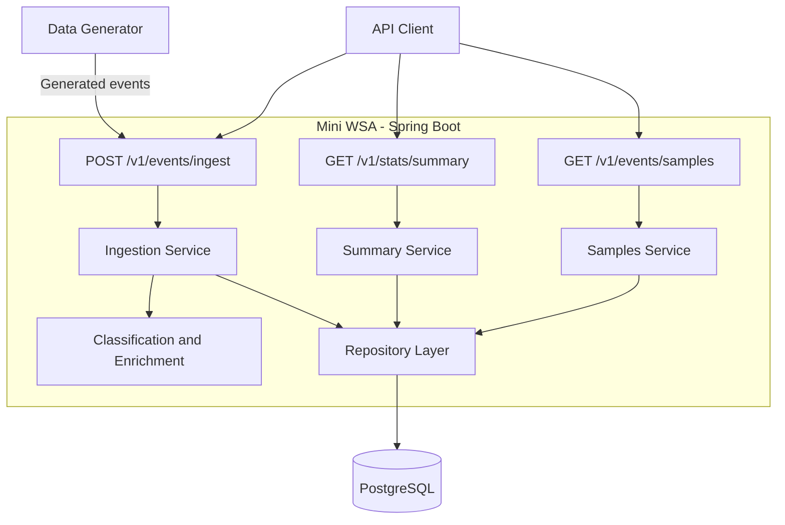

# Mini WSA - Initial Design

Status: planning document, written before implementation. The components and behavior below are proposed, not completed features. This document will evolve as the implementation is validated.

## 1. Goal and scope

Build a Java / Spring Boot backend that ingests security events, validates and enriches them, persists them, and exposes summary statistics and individual samples through REST APIs.

Required deliverables:
- Single-event and batch ingestion.
- Attack classification and threat scoring.
- Persistent event storage.
- Summary and samples APIs.
- Configurable data generation, including attack waves.
- Unit tests for classification and enrichment, plus API integration testing.
- Setup instructions, API examples, architecture documentation, and storage justification.

The initial implementation will use one Spring Boot application and PostgreSQL.

## 2. Planned tools

| Tool | Purpose |
| --- | --- |
| Java 21 | Application language and runtime |
| Spring Boot / Spring Web | REST APIs and application configuration |
| Jakarta Validation | Input constraints |
| Maven Wrapper | Repeatable build without a separate Maven installation |
| PostgreSQL | Event storage, filtering, and aggregation |
| Docker Desktop / Docker Compose | Local database; optionally the complete stack |
| JUnit / Spring Boot Test | Unit and integration tests |
| Git / GitHub | Small logical commits and milestone tags |

The database access approach (JPA or JDBC) will be selected during project setup.

## 3. Architecture

All application components below run in the same application. PostgreSQL runs separately.



Controllers handle HTTP input and output. Services coordinate use cases. Classification and scoring are isolated from HTTP and database access. Repositories handle persistence and queries.

## 4. Ingestion API

`POST /v1/events/ingest`

Accept a single event object or an array. Validate required fields, enum values, and timestamp format. Normalize a single event into a list internally.

### Batch handling - design decision

Process items independently in request order. Store valid events even when other items fail validation. Return an index for each item so invalid items can be identified even when their IDs are missing.

| Item status in response JSON | Meaning | Result fields |
| --- | --- | --- |
| 201 | Created | index, eventId, status, full stored event |
| 200 | Already exists | index, eventId, status, full existing event |
| 400 | Validation failure | index, eventId if available, status, errors |

The actual HTTP response has one status code; item statuses are application-defined JSON fields.

| HTTP status | Outcome |
| --- | --- |
| 201 | Every item was newly created |
| 200 | Mixed item outcomes, or every item already existed |
| 400 | Every item failed validation; also malformed JSON or an invalid top-level input |

Return counts named `created`, `existing`, and `rejected`, plus a `results` array. Reject an empty batch with 400. Unexpected infrastructure failures are server errors, not validation rejections; their detailed handling must be addressed during implementation.

The assignment specifies 201 for success and 400 for validation errors, but does not specify mixed-batch behavior. Partial acceptance and the mixed-batch response above are explicit design assumptions.

### Duplicate handling - design decision

Treat `eventId` as globally unique. A valid submission with an existing ID returns the original stored event without inserting another row, recalculating its score, or changing `receivedAt`. The original payload wins, even if a later valid submission has different fields.

Use a database primary key / unique constraint as the final safeguard against concurrent duplicate inserts. Detecting changed payloads and returning a conflict is a future improvement.

### Pseudocode

```text
INGEST(input):
    events = normalize input into a list
    results = empty list

    FOR EACH event IN events, in request order:
        errors = validate(event)
        IF errors exist:
            add rejected result with index and errors
            CONTINUE

        existingEvent = find by eventId
        IF existingEvent exists:
            add existing result with stored event
            CONTINUE

        previousCount = count matching stored events in repeat-offender window
        attackType = classify(event.rule.category)
        threatScore = calculateThreatScore(event, previousCount)
        receivedAt = current server time
        enrichedEvent = original event + enrichment fields
        save enrichedEvent
        add created result with enrichedEvent

    RETURN batch summary and individual results
```

This describes normal processing. Transaction boundaries, concurrent writes, and storage failures require explicit handling during implementation. In particular, a duplicate race must not overwrite or return an unpersisted candidate event.

## 5. Classification and enrichment

| rule.category | attackType |
| --- | --- |
| INJECTION | SQL/Command Injection |
| XSS | Cross-Site Scripting |
| PROTOCOL_VIOLATION | Protocol Anomaly |
| DATA_LEAKAGE | Data Exfiltration |
| BOT | Bot Activity |
| DOS | Denial of Service |
| RATE_LIMIT | Rate Limiting |

Classification is a deterministic mapping, not an ML prediction.

```text
CALCULATE_THREAT_SCORE(event, previousCount):
    score = severity points: CRITICAL=40, HIGH=30, MEDIUM=20, LOW=10
    add action points: DENY=20, ALERT=10, MONITOR=0
    IF path contains "/admin" OR "/login":
        score = score + 15
    IF previousCount >= 5:
        score = score + 15
    RETURN minimum(score, 100)
```

The sensitive-path bonus is applied once, even if both substrings occur. Although current rules total at most 90 points, retain the required cap of 100.

### Repeat-offender assumptions

- Use event time (`timestamp`), not ingestion time (`receivedAt`).
- For an event at time T, count stored events with the same `clientIp` and timestamps in the inclusive interval [T - 10 minutes, T].
- Count across configurations, because the requirement identifies the offender by IP alone.
- Include the current event conceptually: five previously stored matches make the current event the sixth and trigger the bonus.
- Count only successfully stored, unique events. Duplicate submissions do not increase the count.
- Process a batch in request order; earlier saved items can contribute to later items if their timestamps match the window.
- Late arrivals do not retroactively update stored scores. Consequently, scores may depend on arrival order.

Injecting a controllable clock for `receivedAt` will make time-dependent assertions repeatable.

## 6. Summary API

`GET /v1/stats/summary?configId={configId}&from={ISO8601}&to={ISO8601}`

Filter by event `timestamp` and optional `configId`. Omitting `configId` includes all configurations. Use an inclusive `from` and exclusive `to` to avoid double counting adjacent query windows.

Return the requested time range, total count, counts and average scores by category, counts by action, the top 10 IPs by count with average scores, and the top 10 paths by count.

```text
GET_SUMMARY(configId, from, to):
    validate parameters and from <= to
    filters = requested time range + optional configId
    totalEvents = count matching events
    byCategory = group by category, calculate count and average threatScore
    byAction = group by action, calculate count
    topAttackers = group by clientIp, calculate count and average threatScore
                   order by count descending, then clientIp ascending; take 10
    topTargetedPaths = group by path, calculate count
                       order by count descending, then path ascending; take 10
    RETURN summary
```

All aggregations must use the same filters and execute in the database rather than loading all events into Java memory. Empty results return 200 with zero total, empty maps, and empty lists. Invalid parameters return 400.

The assignment does not explicitly define whether summary `from` and `to` may be omitted. Their requiredness/defaults must be settled before implementation.

## 7. Samples API

`GET /v1/events/samples?configId={}&from={}&to={}&category={}&action={}&limit={}&offset={}`

All parameters are optional. Return full enriched events, the total count before pagination, limit, and offset.

```text
GET_SAMPLES(configId, from, to, category, action, limit, offset):
    default missing limit to 20
    default missing offset to 0
    validate 1 <= limit <= 100 and offset >= 0
    validate supplied enums and timestamps
    validate from <= to if both supplied
    filters = supplied filters, using event timestamp
    total = count all matching events
    events = fetch matching events:
        order by timestamp descending, then eventId ascending
        skip offset; take limit
    RETURN events, total, limit, offset
```

Use inclusive `from` and exclusive `to`. The secondary sort defines the order when timestamps match. An offset beyond the matching total returns 200 with an empty list and the actual total. Invalid parameters return 400. Concurrent inserts can shift offset-based pages; snapshot-stable pagination is outside the initial scope.

## 8. Storage design

Use one `security_events` table. Preserve every original event field plus `attack_type`, `threat_score`, and `received_at`.

Flatten nested objects into columns such as `rule_id`, `rule_name`, `rule_message`, `rule_severity`, `rule_category`, `geo_country`, and `geo_city`. Reconstruct `rule` and `geoLocation` in API responses. Keep the API model separate from storage representation.

Use `event_id` as the primary key. Use timezone-aware timestamps and normalize API output to UTC. Do not choose arbitrary short string limits that reject otherwise valid event data.

Initial additional indexes:
- `(client_ip, event_timestamp)` for repeat-offender counts.
- `(config_id, event_timestamp)` for configuration/time filters.

Cross-configuration time queries may benefit from a timestamp-leading index; evaluate this with query plans and representative data before adding it.

### Why PostgreSQL?

It provides uniqueness constraints, transactions, range filtering, and SQL aggregation in a single dependency. It is suitable for this assignment's scope. This is not a claim that the same deployment handles the production platform's scale.

At larger scale, evaluate time partitioning, retention, batch writes, pre-aggregation, asynchronous ingestion, and analytical storage based on measured bottlenecks. Each additional index improves some reads but adds write and storage cost.

## 9. Data generation

Start with a Java module that writes a JSON array of valid input events. Submit those events to the ingestion API in batches, so validation, enrichment, and persistence are exercised. Do not insert generated data directly into the database.

```text
GENERATE_EVENTS(eventCount, seed):
    initialize seeded random generator
    create varied valid events with unique IDs
    include attack waves: same IP and path, multiple events within 10 minutes
    produce exactly eventCount events
    sort by timestamp ascending
    write JSON file
```

The generator must not generate server-owned enrichment fields. Use dedicated fixtures for invalid events and duplicates. A seed enables repeatable content; repeated submission of the same generated file also tests deduplication.

## 10. Verification plan

| Area | Meaningful checks |
| --- | --- |
| Classification | Every required category mapping |
| Scoring | Severity/action values; sensitive-path bonus applied once |
| Repeat offender | Four vs. five previous events; time boundaries; future events excluded |
| Duplicates | No extra row, changed score, receivedAt, or inflated count |
| Validation | Required fields, enums, timestamp format, malformed request |
| Batch handling | Valid items survive alongside rejected items; correct result indexes/status |
| Summary | Known counts, averages, top results, and config/time filters |
| Samples | Filtering, deterministic sorting, pagination, and unpaginated total |
| Integration | Ingest via HTTP, persist, and retrieve via Samples |

Unit tests isolate classification and scoring from HTTP/database dependencies. API integration testing should exercise the real PostgreSQL behavior using an isolated test database; choose the setup during implementation.

## 11. Delivery milestones

1. Initial planning commit: this design and a README link.
2. `v0.1-ingestion`: running ingestion and persistence with validation.
3. `v0.2-enrichment`: classification, scoring, and relevant unit tests.
4. `v0.3-stats`: summary queries.
5. `v0.4-samples`: filtering and pagination.
6. Data generator, integration tests, and verified setup/API documentation.

Make small logical commits. Apply milestone tags only after the corresponding behavior works. Final submission is a public GitHub repository with verified build/run instructions.

## 12. Open details and future improvements

Resolve before implementing the affected behavior:
- Exact required/optional field constraints, including nested fields.
- Summary time parameter requiredness and response shape when configId is omitted.
- Transaction boundaries and storage-failure responses under partial acceptance.
- Concurrency behavior for repeat-offender counts; a sequential batch does not serialize separate HTTP requests.
- Practical batch-size limits.

Potential later improvements:
- Detect different payloads using the same eventId and report a conflict.
- Retention and partitioning for larger datasets.
- Cursor pagination for frequently changing datasets.
- Metrics and structured logs without exposing sensitive event details.
- One optional bonus feature, after core requirements work.

Record actual implementation challenges, solutions, and something learned after encountering them; do not present planned work as completed experience.