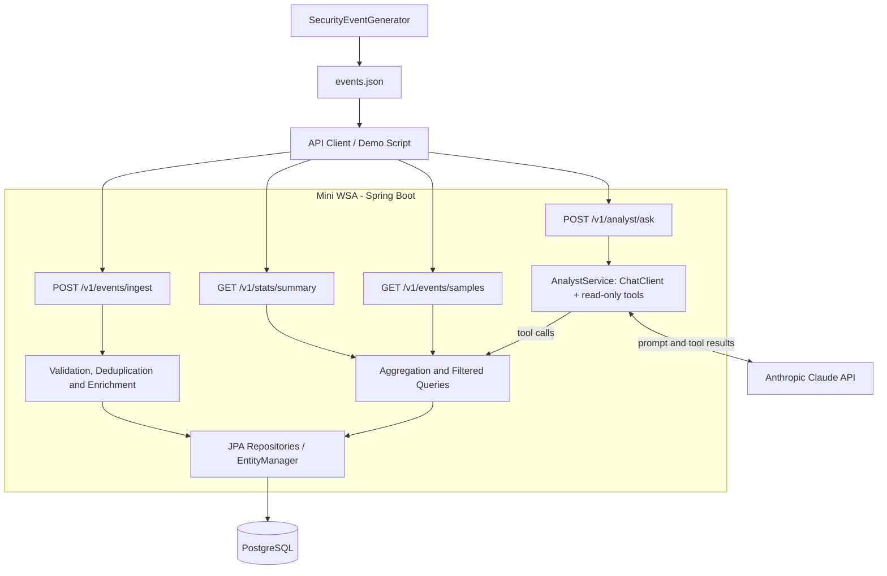

# Mini WSA - Security Analytics Pipeline

A Java / Spring Boot backend for ingesting security events, classifying attacks, calculating threat scores, storing enriched events, and querying analytics. An AI analyst endpoint answers natural-language questions about the stored events. It uses Claude and tool calling over the same analytics APIs.

Built as a backend design exercise. See [Design & Architecture](DESIGN.md) for the initial planning and design assumptions. The implementation notes below describe the delivered behavior where it differs from the initial plan.

## Technology

- Java 21 and Spring Boot 4.1.1
- Maven Wrapper
- Spring Web, Jakarta Validation, Spring Data JPA / Hibernate
- PostgreSQL 17, running through Docker Compose
- Jackson 3
- JUnit and Mockito
- Spring AI 2.0 with Anthropic Claude, for the AI analyst

## Architecture

One Spring Boot application exposes three endpoints. PostgreSQL runs as a separate container.



Controllers handle HTTP. Services coordinate processing. Classification and scoring are independent of database access. A mapper converts between API models and the flat storage representation.

## Prerequisites

- JDK 21, available through `java` and `JAVA_HOME`
- Docker Desktop running with Linux containers
- Git
- Windows PowerShell for the commands and demo script below
- An Anthropic API key, only for the AI analyst endpoint (see [AI analyst](#ai-analyst))

Maven and PostgreSQL do not need separate installations. The wrapper downloads Maven, and Compose starts PostgreSQL.

## Build and run

Run the commands from the repository root.

### 1. Start PostgreSQL

```powershell
docker compose up -d
docker compose ps
```

Wait until the database reports `healthy`. It is exposed at `localhost:5432`. The `postgres_data` named volume preserves data across container recreation.

The application configuration and Compose file use these local development credentials:

| Setting | Value |
| --- | --- |
| Database | `mini_wsa` |
| Username | `mini_wsa` |
| Password | `local_dev_password` |

Hibernate creates/updates tables and indexes through `spring.jpa.hibernate.ddl-auto=update`. The supplied credentials are local development defaults.

### 2. Create the integration-test database

Run once per fresh database volume:

```powershell
docker compose exec postgres psql -U mini_wsa -d mini_wsa -c "CREATE DATABASE mini_wsa_test;"
```

If it already exists, no further creation is needed. The `test` profile uses this separate database.

### 3. Build and test

```powershell
.\mvnw.cmd package
```

This compiles the application, runs tests, and creates the executable JAR. PostgreSQL must be running because the integration test uses a real database.

### 4. Start the application

```powershell
.\mvnw.cmd spring-boot:run
```

The application listens on `http://localhost:8080`. Alternatively, after packaging:

```powershell
$appJar = Get-ChildItem .\target\*.jar | Select-Object -First 1
java -jar $appJar.FullName
```

Use one startup method at a time. The Boot Maven plugin explicitly selects `com.aseel.mini_wsa.MiniWsaApplication` as the application entry point.

To stop PostgreSQL while preserving its data:

```powershell
docker compose down
```

## Generate data and run the demo

The generator is a separate Java entry point. It does not start Spring or write directly to PostgreSQL. It accepts three positional arguments:

| Argument | Default |
| --- | --- |
| Number of events | `10000` |
| Output file | `events.json` |
| Random seed | `42` |

To run without an IDE, build a dependency classpath and launch the generator:

```powershell
.\mvnw.cmd compile dependency:build-classpath "-Dmdep.outputFile=target/classpath.txt"
$generatorClasspath = "target/classes;" + (Get-Content -Raw .\target\classpath.txt).Trim()
java -cp $generatorClasspath com.aseel.mini_wsa.generator.SecurityEventGenerator 10000 events.json 42
```

Alternatively, run `SecurityEventGenerator.main` from VS Code; it uses the defaults when no arguments are supplied.

Generated events include all original event fields and varied configurations, categories, severities, and actions. The first ten events in every block of fifty form a wave with a shared IP, configuration, and login path, spaced one second apart. Timestamps start at `2026-10-20T10:00:00Z`. Locations and user agents are synthetic examples, not actual GeoIP or browser analysis.

The same arguments generate the same data and IDs. A different seed creates a different ID namespace. The generated file is excluded from Git.

With the application running, execute the demo in another terminal:

```powershell
powershell.exe -NoProfile -ExecutionPolicy Bypass -File .\demo.ps1
```

This applies the execution-policy override only to that PowerShell process. If script execution is already allowed, `.\demo.ps1` is sufficient.

The script:

1. Sends events in batches of 100 and prints created/existing/rejected totals.
2. Queries Summary over the file's timestamp range.
3. Retrieves three Samples in that range.
4. Queries Time Series using five-minute buckets over the same range.

Optional parameters:

```powershell
powershell.exe -NoProfile -ExecutionPolicy Bypass -File .\demo.ps1 -BaseUrl http://localhost:8080 -InputFile .\events.json -BatchSize 100
```

A fresh 10,000-event import should create 10,000 records. Repeating the same file should return 10,000 existing records. Analytics include any other stored events in the selected range as well.

## API reference

### Ingest events

`POST /v1/events/ingest`

Accepts a single JSON object or a JSON array directly; there is no `events` wrapper. Required fields are `eventId`, `timestamp`, `configId`, `clientIp`, `path`, `rule`, and `action`. Within `rule`, `severity` and `category` are required. Other original fields are optional.

Nonblank constraints apply to required strings. Optional `statusCode` must be 100 - 599; request/response sizes must be nonnegative. IP strings are required to be nonblank but are not currently validated as IP literals.

Example:

```powershell
$json = @'
{
  "eventId": "readme-example-001",
  "timestamp": "2026-10-20T10:00:00Z",
  "configId": 14227,
  "clientIp": "203.0.113.42",
  "path": "/api/login",
  "action": "DENY",
  "rule": { "severity": "HIGH", "category": "INJECTION" }
}
'@

Invoke-RestMethod -Uri "http://localhost:8080/v1/events/ingest" -Method Post -ContentType "application/json" -Body $json |
    ConvertTo-Json -Depth 10
```

The response contains `created`, `existing`, `rejected`, and `results`. Each result contains its zero-based `index`, `eventId` if available, `status`, `validationErrors`, and the full enriched `event` on success. Errors have `field` and `message` properties.

| Item status | Meaning |
| --- | --- |
| 201 | New enriched event inserted |
| 200 | Existing event returned unchanged |
| 400 | Item conversion or validation failed |

| HTTP status | Meaning |
| --- | --- |
| 201 | All items newly created |
| 200 | Mixed outcomes, or all items already existed |
| 400 | All items rejected, or invalid request structure / malformed JSON |

Item statuses are JSON fields; the request has one actual HTTP status. Partial acceptance of mixed batches is a deliberate design choice. Items are processed in request order. A valid item survives another item's rejection. Malformed JSON rejects the whole request.

#### Classification

| Category | attackType |
| --- | --- |
| INJECTION | SQL/Command Injection |
| XSS | Cross-Site Scripting |
| PROTOCOL_VIOLATION | Protocol Anomaly |
| DATA_LEAKAGE | Data Exfiltration |
| BOT | Bot Activity |
| DOS | Denial of Service |
| RATE_LIMIT | Rate Limiting |

#### Threat score

- Severity: CRITICAL=40, HIGH=30, MEDIUM=20, LOW=10.
- Action: DENY=20, ALERT=10, MONITOR=0.
- Case-sensitive path substring `/admin` or `/login`: +15 once.
- At least five previously stored events from the same IP in the ten-minute event-time window: +15.
- Cap at 100.

The repeat-offender interval is inclusive at both ends: `[timestamp - 10 minutes, timestamp]`. Counting spans configurations. The current event is conceptually included, so the sixth event qualifies. Duplicate submissions do not increase counts. Previously stored scores are not retroactively recalculated for late arrivals.

#### Duplicate handling

`eventId` is globally unique. First write wins; a valid resubmission returns the original event without recalculating enrichment. Changed payloads using the same ID are not compared in this version.

An initial lookup handles ordinary retries. Insert-only persistence in a separate transaction and the primary-key constraint prevent concurrent requests from overwriting each other. If an insert encounters an integrity failure, the service looks up the ID again and returns the stored event if found; otherwise it propagates the failure.

### Summary

`GET /v1/stats/summary`

| Parameter | Required | Meaning |
| --- | --- | --- |
| configId | No | Omit to include all configurations |
| from | Yes | ISO8601 timestamp, inclusive |
| to | Yes | ISO8601 timestamp, exclusive |

```powershell
Invoke-RestMethod "http://localhost:8080/v1/stats/summary?from=2026-10-20T10:00:00Z&to=2026-10-20T13:00:00Z" |
    ConvertTo-Json -Depth 10
```

Returns `configId` (null for all), `timeRange`, `totalEvents`, `byCategory` (count and average score), `byAction`, `topAttackers` (top 10 by count with average score), and `topTargetedPaths` (top 10 by count). Ties are ordered by IP/path ascending. Aggregations execute in PostgreSQL.

No matches return 200 with zero total and empty maps/lists. Reversed ranges return 400. Equal bounds are permitted and produce an empty interval.

### Samples

`GET /v1/events/samples`

All parameters are optional: `configId`, `from`, `to`, `category`, `action`, `limit`, and `offset`.

- `from` inclusive and `to` exclusive, filtering on event timestamp.
- `limit`: default 20; allowed 1–100.
- `offset`: default 0; must be nonnegative.
- Order: timestamp descending, then eventId ascending.
- `total` counts all matching records before pagination.

```powershell
Invoke-RestMethod "http://localhost:8080/v1/events/samples?category=BOT&action=DENY&limit=3&offset=0" |
    ConvertTo-Json -Depth 10
```

Returns `events`, `total`, `limit`, and `offset`. An offset beyond the total returns an empty list with the actual total. Invalid filters/pagination return 400.

### Time Series

`GET /v1/stats/timeseries`

Returns event counts grouped into fixed time buckets, suitable for a dashboard chart.

| Parameter | Required | Description |
| --- | --- | --- |
| configId | No | Omit to include all configurations |
| from | Yes | ISO8601 timestamp, inclusive |
| to | Yes | ISO8601 timestamp, exclusive |
| interval | Yes | `1m`, `5m`, or `1h` |

```powershell
Invoke-RestMethod "http://localhost:8080/v1/stats/timeseries?from=2026-10-20T10:00:00Z&to=2026-10-20T13:00:00Z&interval=5m" |
    ConvertTo-Json -Depth 10
```

Example response:

```json
{
  "configId": null,
  "timeRange": {
    "from": "2026-10-20T10:00:00Z",
    "to": "2026-10-20T10:10:00Z"
  },
  "interval": "5m",
  "buckets": [
    { "timestamp": "2026-10-20T10:00:00Z", "count": 300 },
    { "timestamp": "2026-10-20T10:05:00Z", "count": 300 }
  ]
}
```

Aggregation runs in PostgreSQL using `date_bin`. Buckets are aligned to UTC clock boundaries and sorted chronologically. Only non-empty buckets are returned.

Filtering occurs before aggregation. A partially selected bucket counts only events within the requested range; its start may precede `from`. Events exactly at `to` are excluded.

Unsupported intervals and reversed time ranges return HTTP 400. An empty result returns HTTP 200 with an empty `buckets` list.

An automated HTTP integration test verifies bucket alignment and the exclusive upper time boundary against PostgreSQL.

## AI analyst

`POST /v1/analyst/ask`

Answers natural-language questions about stored events, for example "What was the most common attack category, and who was the top attacker?" The endpoint sends the question to Claude through Spring AI's `ChatClient`. The model does not see the database. It can only call these read-only tools:

| Tool | Backed by | Purpose |
| --- | --- | --- |
| `getDataTimeRange(configId?)` | earliest/latest event timestamps and count | Lets the model find which period contains data before querying it |
| `getSummary(configId?, from, to)` | `EventStatisticsService.summary` (same as `GET /v1/stats/summary`) | Totals, per-category and per-action stats, top attackers and paths |

The model chooses which tools to call and in what order, then writes the answer from the tool results.

### Setup

The endpoint needs an Anthropic API key in the `ANTHROPIC_API_KEY` environment variable. The rest of the application does not use it. The model is set in `application.properties` (`spring.ai.anthropic.chat.model`).

```powershell
setx ANTHROPIC_API_KEY "sk-ant-..."
```

`setx` applies to new processes only, so open a new terminal (or restart the IDE) before starting the application.

### Example

```powershell
$body = @{ question = "What was the most common attack category, and who was the top attacker?" } | ConvertTo-Json
(Invoke-RestMethod -Uri "http://localhost:8080/v1/analyst/ask" -Method Post -ContentType "application/json" -Body $body).answer
```

A real answer over the demo data set:

> You didn't give a time window, so I used all the data available: 2026-10-19 16:00 to 2026-10-20 12:46:39 UTC. That covers 10,003 events.
>
> - **Most common attack category:** BOT, with 3,053 events (about 30% of the total). Its average threat score is 61.4. The other categories each have 1,098 to 1,209 events and average scores of about 40 to 41.
> - **Top attacker:** 203.0.113.5, with 49 events and an average threat score of 41.8.
>
> The top attacker is only slightly ahead of the next ones. 203.0.113.43 has 48 events and 203.0.113.63 has 47. No single IP stands out.

Every number in this answer matches `GET /v1/stats/summary` for the same range. The model first called `getDataTimeRange`, because the question had no time window, and then `getSummary`.

Request body: `{"question": "..."}`. The question must be nonblank and at most 2,000 characters. Response body: `{"answer": "..."}`.

| HTTP status | Meaning |
| --- | --- |
| 200 | Answer returned |
| 400 | Blank or overlong question, or malformed JSON |
| 502 | The AI provider call failed (invalid key, unknown model, rate limit, outage). The client gets a generic message; the full error is logged |

### Design decisions

- **Numbers come from the database, not the model.** Every count, average, IP and path is computed by PostgreSQL through the existing analytics services. The system prompt forbids inventing values and tells the model to say when the data is insufficient.
- **Orientation before querying.** The model has no knowledge of when data exists. `getDataTimeRange` lets it find the populated period, and the system prompt includes the current UTC time. A question such as "What happened in the last hour?" over old demo data returns an explanation that there are no recent events and when the stored events are, instead of reporting a quiet hour.
- **Errors are returned to the model.** Tools parse timestamps themselves. Invalid or missing values raise an exception whose message states what was wrong and the expected format (ISO-8601 UTC). Spring AI returns the message to the model as the tool result, so the model can correct the call.
- **Attacker-controlled data is untrusted.** Fields such as `path`, rule messages and user agents come from the traffic being analyzed and can contain text written to look like instructions (prompt injection). Tools are read-only, and the system prompt instructs the model to treat tool results strictly as data.
- **Provider failures map to 502.** Anthropic SDK errors (`AnthropicException`) are handled in `ApiExceptionHandler`. The response does not expose the model name, request ID or provider message.

## Storage choice and indexes

PostgreSQL provides durable storage, uniqueness constraints, transactions, time-range filtering, and aggregation with one dependency. It suits this project's scope and keeps operational setup straightforward. This deployment is not designed for production-scale throughput.

One row stores one enriched event. Nested rule/location objects are flattened into columns and reconstructed for API responses. Enums are stored by name.

Indexes:

- Primary key on `event_id`.
- `(client_ip, event_timestamp)` for repeat-offender counts.
- `(config_id, event_timestamp)` for configuration/time queries.
- `(event_timestamp)` for time queries across configurations.

## Testing and verification

```powershell
.\mvnw.cmd test
```

Automated tests cover all seven classification mappings, threat-scoring boundaries, HTTP status-code validation, mixed-batch handling, and PostgreSQL-backed analytics.

Query integration tests verify summary counts and averages, top-ten ordering and tie-breaking, sample filters, time boundaries, pagination, and totals before pagination.

AI analyst tool tests (`SecurityAnalyticsToolsTest`) verify timestamp parsing, the error messages returned to the model for missing or non-ISO values, that invalid input never reaches the statistics service, and delegation of `configId`. Tests do not call the real model. The `test` profile sets a placeholder API key.

## Challenges and lessons learned

- Supporting partial batch success required converting and validating each event separately. This allows valid events to be stored even when another event contains an invalid enum or a missing required field.
- Checking whether an event exists before saving does not prevent concurrent requests from using the same ID. Insert-only persistence and the database primary key prevent overwriting an existing event.
- An integration test revealed a timestamp precision difference between Java and PostgreSQL. Truncating server-generated receivedAt to microseconds keeps the initial and duplicate responses consistent.

## Limitations and next improvements

- Concurrent events from the same IP may receive a score based on the same previous event count. Strict scoring under concurrency would require additional coordination.
- Incoming timestamps with nanosecond precision may be rounded when stored. I would make timestamp precision consistent throughout the ingestion flow.
- The API does not currently limit batch size. I would add a configurable maximum to control memory usage and request processing time.
- If a database failure interrupts a batch, earlier events may already be stored. Clients can retry the batch; stored event IDs are returned without being inserted again.
- Offset pagination may shift when new events arrive between requests.
- The generator and demo load events into memory. For larger datasets, I would generate and send smaller batches incrementally.
- The project uses automatic schema updates and local development credentials for simplicity. These settings would need to be adapted for deployment.
- The application itself is not yet containerized; adding an application image to Compose is a planned next step.
- The AI analyst currently exposes summary and data-range tools only. Samples and time-series tools would let it inspect individual events and detect spikes.
- AI analyst answers are verified manually against the analytics endpoints. There is no automated end-to-end evaluation against the real model yet.
- The AI analyst has no retrieval (RAG) over mitigation guidance yet. A planned next step is a pgvector-backed playbook store exposed as an additional tool. The Compose image already includes pgvector.
- Each question is answered independently; there is no conversation memory.