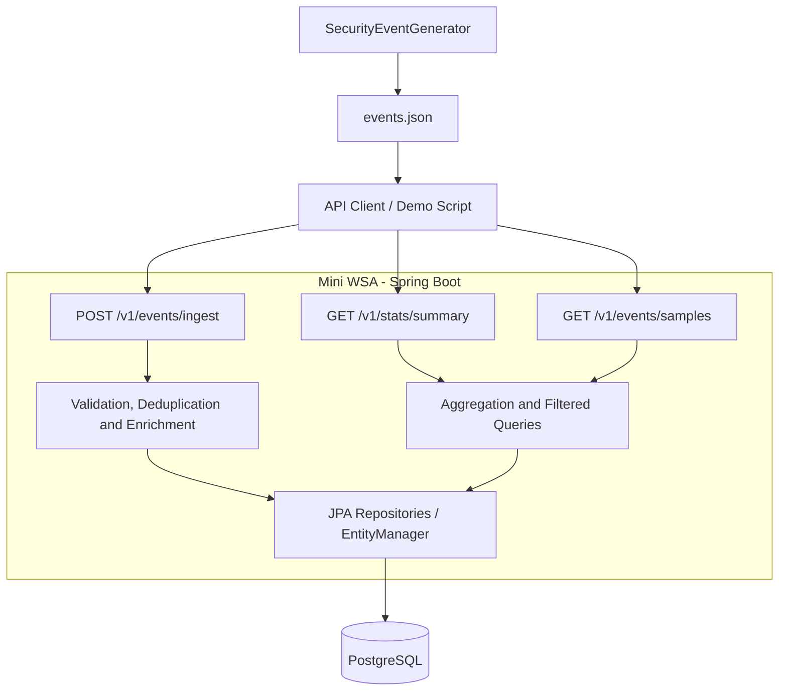

# Mini WSA — Security Analytics Pipeline

A Java / Spring Boot backend for ingesting security events, classifying attacks, calculating threat scores, storing enriched events, and querying analytics.

Implemented for the Akamai backend assignment. See [Design & Architecture](DESIGN.md) for the initial planning and design assumptions. The implementation notes below describe the delivered behavior where it differs from the initial plan.

## Technology

- Java 21 and Spring Boot 4.1.1
- Maven Wrapper
- Spring Web, Jakarta Validation, Spring Data JPA / Hibernate
- PostgreSQL 17, running through Docker Compose
- Jackson 3
- JUnit and Mockito

## Architecture

One Spring Boot application exposes three endpoints. PostgreSQL runs as a separate container.



Controllers handle HTTP. Services coordinate processing. Classification and scoring are independent of database access. A mapper converts between API models and the flat storage representation.

## Prerequisites

- JDK 21, available through `java` and `JAVA_HOME`
- Docker Desktop running with Linux containers
- Git
- Windows PowerShell for the commands and demo script below

Maven and PostgreSQL do not need separate installations. The wrapper downloads Maven, and Compose starts PostgreSQL.

## Build and run

Run the commands from the repository root.

### 1. Start PostgreSQL

```powershell
docker compose up -d
docker compose ps
```

Wait until the database reports `healthy`. It is exposed at `localhost:5432`. The `postgres_data` named volume preserves data across container recreation.

The application configuration and Compose file use these local development credentials:

| Setting | Value |
| --- | --- |
| Database | `mini_wsa` |
| Username | `mini_wsa` |
| Password | `local_dev_password` |

Hibernate creates/updates tables and indexes through `spring.jpa.hibernate.ddl-auto=update`. The supplied credentials are local development defaults.

### 2. Create the integration-test database

Run once per fresh database volume:

```powershell
docker compose exec postgres psql -U mini_wsa -d mini_wsa -c "CREATE DATABASE mini_wsa_test;"
```

If it already exists, no further creation is needed. The `test` profile uses this separate database.

### 3. Build and test

```powershell
.\mvnw.cmd package
```

This compiles the application, runs tests, and creates the executable JAR. PostgreSQL must be running because the integration test uses a real database.

### 4. Start the application

```powershell
.\mvnw.cmd spring-boot:run
```

The application listens on `http://localhost:8080`. Alternatively, after packaging:

```powershell
$appJar = Get-ChildItem .\target\*.jar | Select-Object -First 1
java -jar $appJar.FullName
```

Use one startup method at a time. The Boot Maven plugin explicitly selects `com.aseel.mini_wsa.MiniWsaApplication` as the application entry point.

To stop PostgreSQL while preserving its data:

```powershell
docker compose down
```

## Generate data and run the demo

The generator is a separate Java entry point. It does not start Spring or write directly to PostgreSQL. It accepts three positional arguments:

| Argument | Default |
| --- | --- |
| Number of events | `10000` |
| Output file | `events.json` |
| Random seed | `42` |

To run without an IDE, build a dependency classpath and launch the generator:

```powershell
.\mvnw.cmd compile dependency:build-classpath "-Dmdep.outputFile=target/classpath.txt"
$generatorClasspath = "target/classes;" + (Get-Content -Raw .\target\classpath.txt).Trim()
java -cp $generatorClasspath com.aseel.mini_wsa.generator.SecurityEventGenerator 10000 events.json 42
```

Alternatively, run `SecurityEventGenerator.main` from VS Code; it uses the defaults when no arguments are supplied.

Generated events include all original event fields and varied configurations, categories, severities, and actions. The first ten events in every block of fifty form a wave with a shared IP, configuration, and login path, spaced one second apart. Timestamps start at `2026-10-20T10:00:00Z`. Locations and user agents are synthetic examples, not actual GeoIP or browser analysis.

The same arguments generate the same data and IDs. A different seed creates a different ID namespace. The generated file is excluded from Git.

With the application running, execute the demo in another terminal:

```powershell
powershell.exe -NoProfile -ExecutionPolicy Bypass -File .\demo.ps1
```

This applies the execution-policy override only to that PowerShell process. If script execution is already allowed, `.\demo.ps1` is sufficient.

The script:

1. Sends events in batches of 100 and prints created/existing/rejected totals.
2. Queries Summary over the file's timestamp range.
3. Retrieves three Samples in that range.

Optional parameters:

```powershell
powershell.exe -NoProfile -ExecutionPolicy Bypass -File .\demo.ps1 -BaseUrl http://localhost:8080 -InputFile .\events.json -BatchSize 100
```

A fresh 10,000-event import should create 10,000 records. Repeating the same file should return 10,000 existing records. Analytics include any other stored events in the selected range as well.

## API reference

### Ingest events

`POST /v1/events/ingest`

Accepts a single JSON object or a JSON array directly; there is no `events` wrapper. Required fields are `eventId`, `timestamp`, `configId`, `clientIp`, `path`, `rule`, and `action`. Within `rule`, `severity` and `category` are required. Other original fields are optional.

Nonblank constraints apply to required strings. Optional `statusCode` must be 100–599; request/response sizes must be nonnegative. IP strings are required to be nonblank but are not currently validated as IP literals.

Example:

```powershell
$json = @'
{
  "eventId": "readme-example-001",
  "timestamp": "2026-10-20T10:00:00Z",
  "configId": 14227,
  "clientIp": "203.0.113.42",
  "path": "/api/login",
  "action": "DENY",
  "rule": { "severity": "HIGH", "category": "INJECTION" }
}
'@

Invoke-RestMethod -Uri "http://localhost:8080/v1/events/ingest" -Method Post -ContentType "application/json" -Body $json |
    ConvertTo-Json -Depth 10
```

The response contains `created`, `existing`, `rejected`, and `results`. Each result contains its zero-based `index`, `eventId` if available, `status`, `validationErrors`, and the full enriched `event` on success. Errors have `field` and `message` properties.

| Item status | Meaning |
| --- | --- |
| 201 | New enriched event inserted |
| 200 | Existing event returned unchanged |
| 400 | Item conversion or validation failed |

| HTTP status | Meaning |
| --- | --- |
| 201 | All items newly created |
| 200 | Mixed outcomes, or all items already existed |
| 400 | All items rejected, or invalid request structure / malformed JSON |

Item statuses are JSON fields; the request has one actual HTTP status. Partial acceptance is a documented interpretation of the assignment's unspecified mixed-batch behavior. Items are processed in request order. A valid item survives another item's rejection. Malformed JSON rejects the whole request.

#### Classification

| Category | attackType |
| --- | --- |
| INJECTION | SQL/Command Injection |
| XSS | Cross-Site Scripting |
| PROTOCOL_VIOLATION | Protocol Anomaly |
| DATA_LEAKAGE | Data Exfiltration |
| BOT | Bot Activity |
| DOS | Denial of Service |
| RATE_LIMIT | Rate Limiting |

#### Threat score

- Severity: CRITICAL=40, HIGH=30, MEDIUM=20, LOW=10.
- Action: DENY=20, ALERT=10, MONITOR=0.
- Case-sensitive path substring `/admin` or `/login`: +15 once.
- At least five previously stored events from the same IP in the ten-minute event-time window: +15.
- Cap at 100.

The repeat-offender interval is inclusive at both ends: `[timestamp - 10 minutes, timestamp]`. Counting spans configurations. The current event is conceptually included, so the sixth event qualifies. Duplicate submissions do not increase counts. Previously stored scores are not retroactively recalculated for late arrivals.

#### Duplicate handling

`eventId` is globally unique. First write wins; a valid resubmission returns the original event without recalculating enrichment. Changed payloads using the same ID are not compared in this version.

An initial lookup handles ordinary retries. Insert-only persistence in a separate transaction and the primary-key constraint prevent concurrent requests from overwriting each other. If an insert encounters an integrity failure, the service looks up the ID again and returns the stored event if found; otherwise it propagates the failure.

### Summary

`GET /v1/stats/summary`

| Parameter | Required | Meaning |
| --- | --- | --- |
| configId | No | Omit to include all configurations |
| from | Yes | ISO8601 timestamp, inclusive |
| to | Yes | ISO8601 timestamp, exclusive |

```powershell
Invoke-RestMethod "http://localhost:8080/v1/stats/summary?from=2026-10-20T10:00:00Z&to=2026-10-20T13:00:00Z" |
    ConvertTo-Json -Depth 10
```

Returns `configId` (null for all), `timeRange`, `totalEvents`, `byCategory` (count and average score), `byAction`, `topAttackers` (top 10 by count with average score), and `topTargetedPaths` (top 10 by count). Ties are ordered by IP/path ascending. Aggregations execute in PostgreSQL.

No matches return 200 with zero total and empty maps/lists. Reversed ranges return 400. Equal bounds are permitted and produce an empty interval.

### Samples

`GET /v1/events/samples`

All parameters are optional: `configId`, `from`, `to`, `category`, `action`, `limit`, and `offset`.

- `from` inclusive and `to` exclusive, filtering on event timestamp.
- `limit`: default 20; allowed 1–100.
- `offset`: default 0; must be nonnegative.
- Order: timestamp descending, then eventId ascending.
- `total` counts all matching records before pagination.

```powershell
Invoke-RestMethod "http://localhost:8080/v1/events/samples?category=BOT&action=DENY&limit=3&offset=0" |
    ConvertTo-Json -Depth 10
```

Returns `events`, `total`, `limit`, and `offset`. An offset beyond the total returns an empty list with the actual total. Invalid filters/pagination return 400.

## Storage choice and indexes

PostgreSQL provides durable storage, uniqueness constraints, transactions, time-range filtering, and aggregation with one dependency. It suits this assignment's scope and keeps operational setup straightforward. This deployment is not claimed to match production WSA throughput.

One row stores one enriched event. Nested rule/location objects are flattened into columns and reconstructed for API responses. Enums are stored by name.

Indexes:

- Primary key on `event_id`.
- `(client_ip, event_timestamp)` for repeat-offender counts.
- `(config_id, event_timestamp)` for configuration/time queries.
- `(event_timestamp)` for time queries across configurations.

## Testing and verification

```powershell
.\mvnw.cmd test
```

Unit tests cover validation, classification/scoring, continuation after an invalid batch item, and simulated concurrent-insert failure handling. The API integration test starts Spring on a random port with the `test` profile, inserts through HTTP into PostgreSQL, and verifies that resubmission returns the same event.

Manual verification also exercised summary filters, empty/reversed ranges, samples pagination and combined filters, a mixed batch, and importing/replaying 10,000 generated events. Manual checks complement the automated suite; they are not automated performance benchmarks. The concurrency unit test simulates a race outcome rather than running simultaneous database requests.

## Challenges and lessons learned

- Partial batches require per-item JSON conversion: directly binding an entire array of typed events could reject the request before individual results are produced. Conversion errors and Bean Validation errors are returned using the same error DTO.
- A lookup followed by `save` is insufficient for concurrent first-write-wins semantics. Insert-only persistence and a database uniqueness constraint provide the final protection.
- The HTTP integration test exposed timestamp precision differences: Java `Instant` may contain nanoseconds, while PostgreSQL stores microseconds. Server-generated `receivedAt` is truncated to microseconds before insertion so initial and duplicate responses agree.

## Limitations and next improvements

- Repeat-offender count and insert are not serialized per IP. Concurrent distinct events can observe the same prior count near the threshold. Address with a per-IP database coordination strategy or partitioned processing if strict concurrent scoring is required.
- Incoming event timestamps with sub-microsecond precision are not yet normalized consistently with database precision. `receivedAt` is normalized.
- Ingestion is synchronous, with a transaction per new event. There is no enforced server-side batch-size limit; the demo uses batches of 100.
- Infrastructure failures can interrupt a batch after some earlier items have committed. Clients can safely retry stored IDs.
- Offset pagination can shift under concurrent inserts. Cursor pagination would improve stability and large-offset behavior.
- Summary aggregates use separate queries, so concurrent writes can cause small cross-query inconsistencies. A repeatable-read snapshot is a possible improvement.
- The generator and demo load the generated file/data into memory; streaming generation and ingestion would suit larger volumes.
- Test data is isolated from the application database, but integration-test records currently remain between runs with unique IDs. Add targeted cleanup or disposable databases.
- Replace automatic schema updates with versioned migrations, externalize environment-specific configuration, and add request metrics and operational monitoring.
- Add automated query tests with controlled datasets, query-plan/performance measurements, retention/time partitioning, and pre-aggregation as justified by scale.
- Optional bonus endpoints and a full app-plus-database Compose deployment are not implemented.